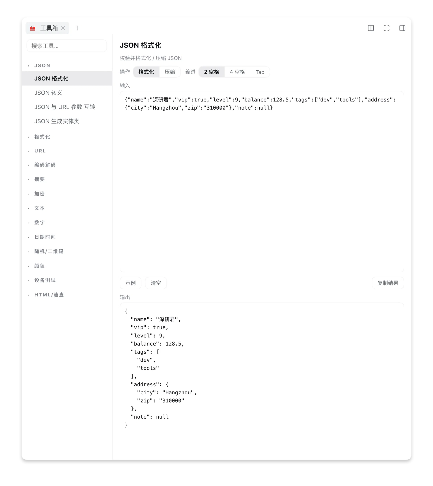
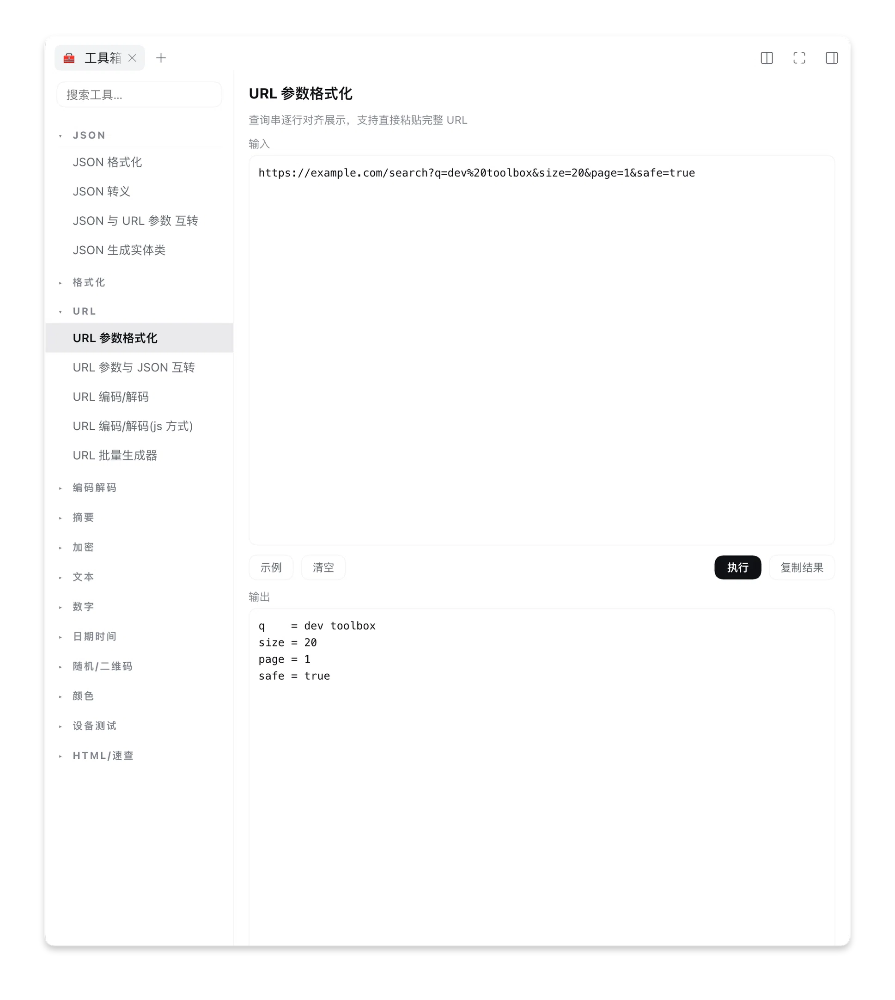

# dsh-dev-toolbox

[中文](#中文) | [English](#english)

<a id="中文"></a>

## 中文

DSH（the agent harness）侧边栏工具箱插件：把 toolhelper.cn 风格的常用开发工具装进 better-sidebar 的侧边栏。

**版本：v0.1.0** · 77 个工具 · 13 个分组 · 纯浏览器端执行，零网络请求（输入数据不出本机）。

### 使用示例

JSON 格式化——校验并格式化 / 压缩 JSON，支持缩进切换：



URL 参数格式化——查询串逐行对齐展示，支持直接粘贴完整 URL：



### 功能

**JSON**
- JSON 格式化（缩进 2/4/Tab、压缩、校验报错）
- JSON 转义 / 去转义
- JSON 与 URL 参数互转
- JSON 生成实体类（TypeScript / Java / C# / Go / Swift）

**格式化**
- HTML / JavaScript / CSS / JSON / XML（js-beautify）
- C / C++ / C# / Java / PHP（js-beautify 的 C 系模式）
- SQL（轻量关键字缩进）
- Yaml / Python（安全整理：行尾空白、空行归一）
- Nginx（大括号缩进）

**URL**
- URL 参数格式化
- URL 参数与 JSON 互转
- URL 编码/解码（encodeURIComponent / encodeURI 及对应解码）
- URL 批量生成器

**编码解码**
- Base64（含 URL-safe）/ 图片 ↔ Base64 / Unicode 转义 / Hex
- 乱码反解（UTF-8/GBK/Big5/Shift_JIS 等 8 种编码组合评分）
- 进制转换（2-36 BigInt、补码模式）/ 字节序（大小端 u16/u32/f32/f64）
- JWT 解析验签 / Gzip·Deflate 压缩 / Punycode·IDN / QP 编码
- Base32 / Base58 / Base62 / Base85(ASCII85) / 字节数组有·无符号互转

**摘要与加密**
- 一键摘要：MD5 / SHA1 / SHA256 / SHA384 / SHA512 / CRC-8/16/32 / BCC·LRC
- 文件 Hash（≤64MB）/ HMAC（SHA 系 + MD5）
- AES-CBC（PKCS7）/ XOR / RC4 / 摩斯密码 / 凯撒密码

**文本处理**
- 文本对比（LCS diff）/ 去重 / 字数统计 / 高级行处理 / 正则测试 / KV 转代码

**数字与日期**
- chmod 计算 / IEEE754 浮点 / 原码反码补码 / 模幂 / 十六进制计算器
- 人民币大写 / BMI / 单位换算（长度·重量·数据·面积）
- Unix 时间戳 / Cron 解析 / 日期差计算 / 闰年判断

**随机与生成**
- UUID v4 / 随机密码 / 随机数 / 二维码生成（PNG Data URL）

**颜色与设备**
- RGB·HEX·HSL 互转 / 屏幕取色器（EyeDropper）
- 键盘按键测试 / 鼠标按键测试

**HTML 与速查**
- HTML 转义 / Meta Tag 提取 / 文本转 HTML 表格 / Markdown 预览
- HTTP 状态码 / 方法 / MIME / ASCII 速查表

### 构建与挂载

```bash
npm run build        # esbuild 打包 client（含 js-beautify、qrcode），手工包 __ModuleLoader__ wrapper
npm test             # node scripts/smoke.mjs（169 项断言，需 Node 22）
```

挂到 desktop profile（`~/.dsh/profiles/desktop`）：

1. `package.json` dependencies 加 `"dsh-dev-toolbox": "link:/Users/joshuachen/AIProject/dsh-dev-toolbox"`
2. `dsh.profile.bundles` 加 `"dsh-dev-toolbox"`
3. `pnpm install`（生成 node_modules 链接）
4. 浏览器硬刷新（client 半热加载）

### 结构

- `index.js` 宿主半空壳 cordis 插件
- `src/client.js` client 入口：`window.__ModuleLoader__.load({ id, factory })`，注册 better-sidebar tab
- `src/tools.js` 工具聚合入口（GROUPS 分组 + TOOLS 注册表）
- `src/tools/*.js` 各分组工具实现（encode / hash / text / numtime / misc / legacy，纯函数）
- `src/toolbox.js` React UI（工具列表 + 输入输出面板，--dsw-alias-* 主题令牌，分组可折叠）
- `src/custom.js` 特殊交互工具的自定义渲染器（图片 Base64、文件 Hash、取色器、键鼠测试）
- `scripts/build.mjs` esbuild 构建脚本
- `scripts/smoke.mjs` 全工具冒烟测试（sample 遍历 + action 组合 + 已知答案断言）
- `cordis.patch.yml` bundle 挂载补丁（insert dev-toolbox）

---

<a id="english"></a>

## English

A sidebar toolbox plugin for DSH (the agent harness): brings toolhelper.cn-style developer utilities into the better-sidebar panel.

**Version: v0.1.0** · 77 tools · 13 groups · Runs entirely in the browser with zero network requests (your data never leaves the machine).

### Screenshots

JSON formatter — validate & format / minify, with indent options:


URL params formatter — aligned query-string view, accepts a full pasted URL:


### Features

**JSON**
- JSON formatter (indent 2/4/Tab, minify, validation errors)
- JSON escape / unescape
- JSON ↔ URL params
- JSON → entity classes (TypeScript / Java / C# / Go / Swift)

**Formatters**
- HTML / JavaScript / CSS / JSON / XML (js-beautify)
- C / C++ / C# / Java / PHP (js-beautify C-family modes)
- SQL (lightweight keyword indentation)
- Yaml / Python (safe cleanup: trailing whitespace, blank-line normalization)
- Nginx (brace indentation)

**URL**
- URL params formatter
- URL params ↔ JSON
- URL encode/decode (encodeURIComponent / encodeURI and inverses)
- Bulk URL generator

**Encode / Decode**
- Base64 (URL-safe) / image ↔ Base64 / Unicode escapes / Hex
- Mojibake recovery (scores combinations across UTF-8/GBK/Big5/Shift_JIS etc.)
- Radix conversion (2-36 BigInt, two's-complement mode) / endianness (LE/BE u16/u32/f32/f64)
- JWT parse & verify / Gzip·Deflate / Punycode·IDN / Quoted-Printable
- Base32 / Base58 / Base62 / Base85 (ASCII85) / signed ↔ unsigned byte arrays

**Hash & Crypto**
- All-in-one digests: MD5 / SHA1 / SHA256 / SHA384 / SHA512 / CRC-8/16/32 / BCC·LRC
- File hash (≤64MB) / HMAC (SHA family + MD5)
- AES-CBC (PKCS7) / XOR / RC4 / Morse code / Caesar cipher

**Text**
- Text diff (LCS) / dedupe / counters / advanced line ops / regex tester / KV-to-code

**Numbers & Dates**
- chmod calculator / IEEE754 floats / sign-magnitude·ones'·two's complement / modular exponentiation / hex calculator
- RMB uppercase / BMI / unit conversion (length·weight·data·area)
- Unix timestamp / Cron parser / date difference / leap year

**Random & Generators**
- UUID v4 / password generator / random numbers / QR code (PNG Data URL)

**Color & Devices**
- RGB·HEX·HSL conversion / screen color picker (EyeDropper)
- Keyboard / mouse key testers

**HTML & Reference**
- HTML entity escape / meta tag extractor / text → HTML table / Markdown preview
- HTTP status codes / methods / MIME types / ASCII tables

### Build & Mount

```bash
npm run build        # esbuild bundles the client (js-beautify, qrcode included), hand-wraps the __ModuleLoader__ wrapper
npm test             # node scripts/smoke.mjs (169 assertions, requires Node 22)
```

Mount into the desktop profile (`~/.dsh/profiles/desktop`):

1. Add `"dsh-dev-toolbox": "link:/Users/joshuachen/AIProject/dsh-dev-toolbox"` to `package.json` dependencies
2. Add `"dsh-dev-toolbox"` to `dsh.profile.bundles`
3. `pnpm install` (creates the node_modules link)
4. Hard-refresh the browser (client semi-hot reload)

### Layout

- `index.js` host-side shell cordis plugin
- `src/client.js` client entry: `window.__ModuleLoader__.load({ id, factory })`, registers the better-sidebar tab
- `src/tools.js` tool aggregation (GROUPS + TOOLS registry)
- `src/tools/*.js` per-group tool implementations (encode / hash / text / numtime / misc / legacy, pure functions)
- `src/toolbox.js` React UI (tool list + input/output panes, --dsw-alias-* theme tokens, collapsible groups)
- `src/custom.js` custom renderers for interactive tools (image Base64, file hash, color picker, keyboard/mouse tests)
- `scripts/build.mjs` esbuild build script
- `scripts/smoke.mjs` full-suite smoke test (sample iteration + action combos + known-answer assertions)
- `cordis.patch.yml` bundle mount patch (insert dev-toolbox)
